# Multi-AI Production Pipeline & Visual Automation Showcase: "Fun Cruise" Series

An automated, studio-grade content creation framework engineered for a 120-episode audio-visual YouTube series (~40 mins per episode) targeted at the United States demographic (55+). 

This project demonstrates the transition from random AI prompt generations to a strict, scalable **Visual DNA and Production Pipeline** driven entirely by a **custom Python automation script** and **Claude Code CLI**.

---

## 🛠️ Pipeline Architecture

```text
[Script / Text Prompt Input] 
       │
       ▼
[Custom Python Script]  ─── (Automated OpenAI API / Bulk Prompt & Token Injection)
       │
       ▼
[Claude Code CLI Engine]  ─── (Batch Layout Processing & Illustration Frame Composition)
       │
       ▼
[Production Assets Pack]  ─── (100% Consistent Cinematic 16:9 2D Editorial Prints)
```

- **Automation Engine:** Proprietary Python script executing batch requests via OpenAI API. It handles token formatting, metadata pairing, and automatic parameter injection.
- **Layout & Assembly Framework:** Claude Code CLI for dynamic asset scaling, montage composition, and multi-scene frame layout templates.
- **Visual Engine:** ChatGPT (OpenAI API / DALL-E 3) combined with advanced prompt engineering matrices.
- **Core Logic:** Applying strict software engineering principles to segment AI generations into independent architectural layers (Face/Anatomy Lock vs. Contextual Outfits).

---

## 🧬 Engineering Feature: Algorithmic Character Lock

Managing an ensemble cast of **12 persistent characters across 120 episodes** requires absolute stability. To prevent generative drift and "hallucinations," a strict production matrix of **180 unique contextual outfit sheets** (12 characters × 15 outfits) was engineered.

### Character Production Spec Example (Loretta Calhoun — 2012)
- **Persistent Tokens:** Rigid facial geometry, signature cat-eye rhinestone glasses, specific age (72) tokens, and elegant silhouette proportions.
- **Dynamic Array:** Programmatic script-driven injection of localized garment descriptions (Embarkation luxury, casino nights, beach/surf kits, vintage flashbacks).

---

## 🎬 Production Showcase (The Narrative Arc)

*Note: Below are high-fidelity, production-ready 16:9 cinematic prints delivered by the Python automation pipeline. All assets have passed strict Human-in-the-Loop quality control, ensuring zero AI distortions, perfect hand/object interactions, and unified low-light volumetric shading.*

### 1. Scene Overview & Style Baseline (The Embarkation)
Ensemble cast introduction. Enforcing the core visual DNA: a premium storybook / luxury editorial oil-painting style with golden-hour dynamic lighting.
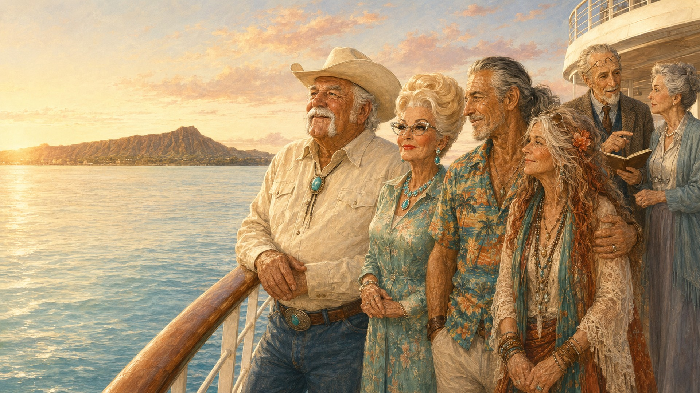

### 2. Multi-Scene Layout Assembly (Leisure Activities)
Demonstration of Claude Code CLI layout compilation. Blending three independent script-specific assets (shuffleboard game, an automated robotic cocktail machine, and a sunset landscape) into a single unified storyboard frame.
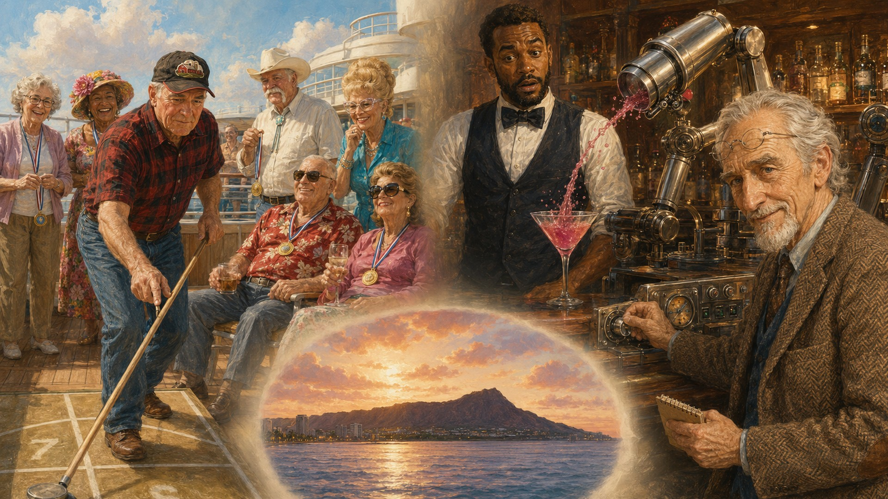

### 3. Dynamic Environment Shift (Hawaiian Port Arrival)
Testing the pipeline's flexibility. Moving all 12 characters into a new environmental architecture (ship ramp, mountains, tropical vegetation) while preserving 100% character facial rigidity.
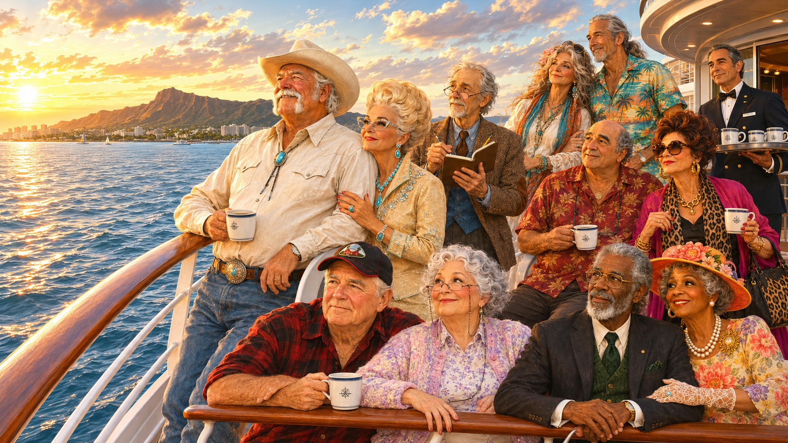

### 4. Situational Humor & Visual Hooks (Waikiki Beach)
Optimizing for user retention. High-density visual framing featuring complex object physics (sand pouring from a leather cowboy boot) designed to capture and hold the target demographic's attention.
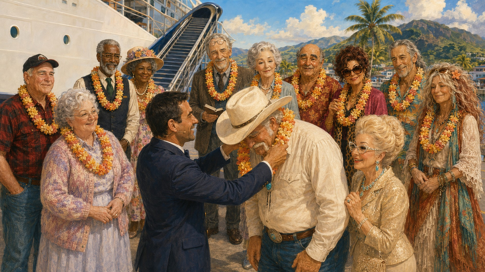

### 5. High-Dynamic Kinetic Physics (Surfing Action)
Controlling complex fluid dynamics (ocean waves, sea foam, splashes) without mutating character muscular structure or age tokens.
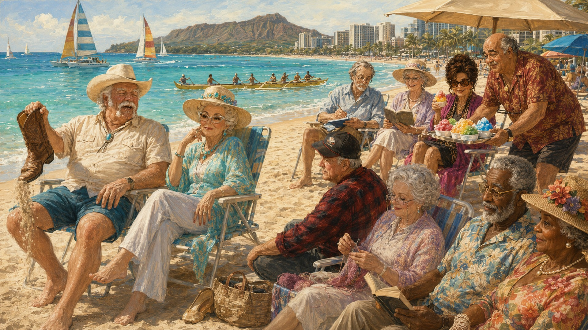

### 6. Deep Narrative & Cultural Resonance (Pearl Harbor Memorial)
Historically and architecturally accurate environment construction (USS Arizona Memorial) with symbolic low-light lighting to trigger deep emotional engagement.
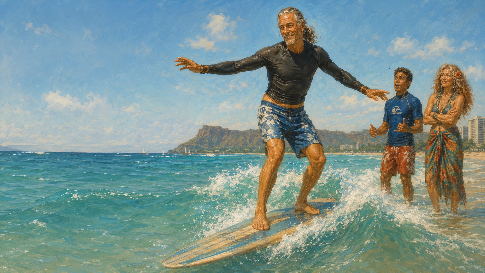

### 7. Multi-Subject Choreography Stress-Test (Hula Dance Lesson)
Stress-testing the system with synchronized crowd poses. Overlaying contextual assets (traditional ti leaf skirts) onto pre-saved character garments without clipping or anatomical distortion.
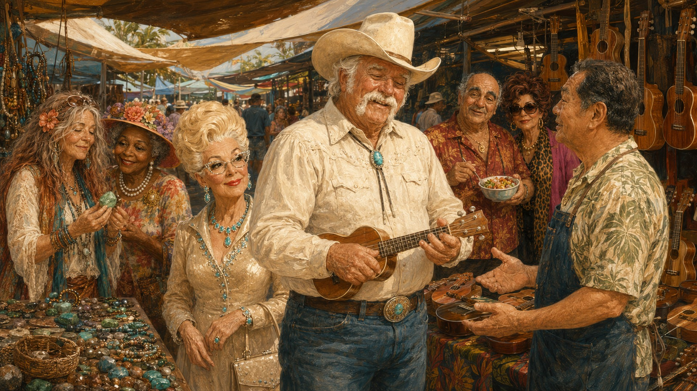

### 8. Volumetric Low-Light & Multi-Planar Depth (Evening Cabin)
Complex spatial orchestration across three depth planes (foreground care interaction, mid-ground cabin reflection, background corridor walk) under harsh, warm rim-lighting.
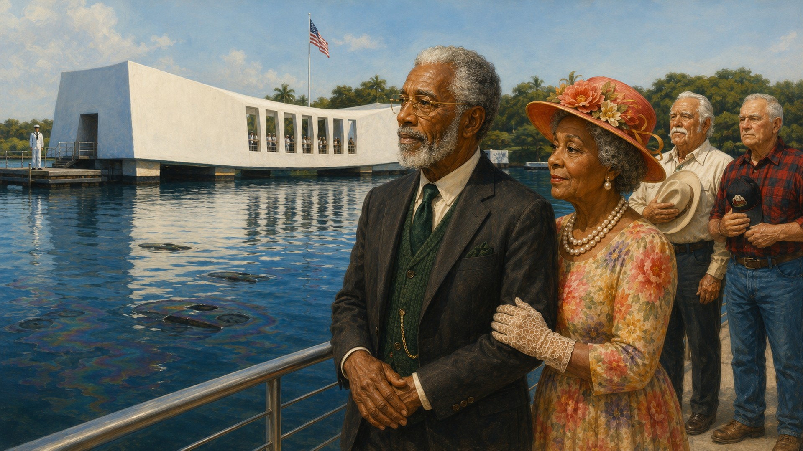

### 9. Volumetric Fire Physics (Night Fire Show)
Extreme high-contrast nighttime rendering. Handling fast-moving fire light loops while maintaining strict brand coloration on characters.
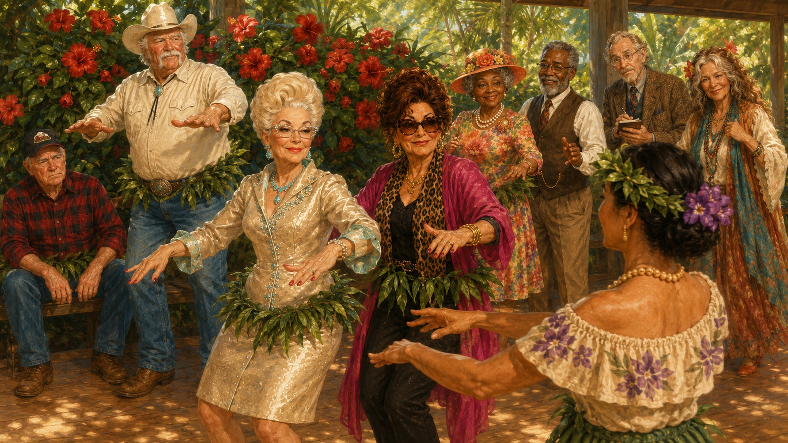

### 10. Narrative Climax & Emotional Synergy (Midnight Dance)
The final resolution. High-empathy human proximity (dancing hand-to-hand grip) under ambient festoon lighting, engineered for maximum audience satisfaction at the end of a 40-minute episode.
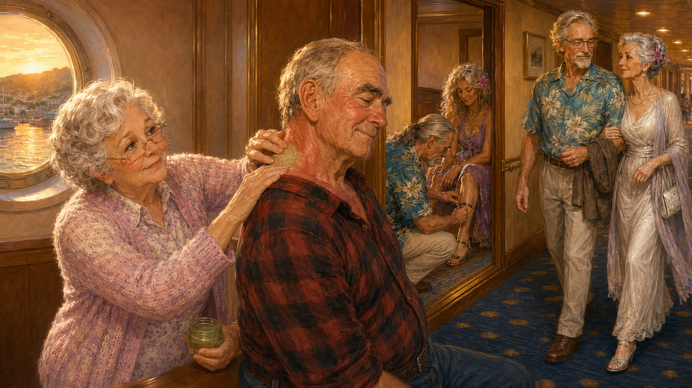

### 11. Multi-Subject Interaction & Prop Control (Local Market)
Managing complex prop handling and close-up texturing. Characters interacting with localized objects (ukuleles, artisanal goods) while maintaining rigid anatomy.
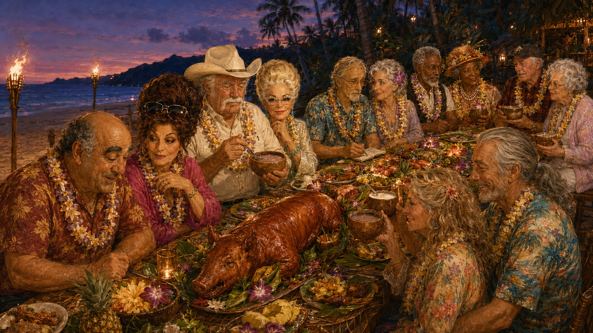

### 12. Atmospheric Environmental Continuity (Island Exploration)
Demonstrating background fidelity and depth scaling during dynamic changes in natural daylight and outdoor shadows.
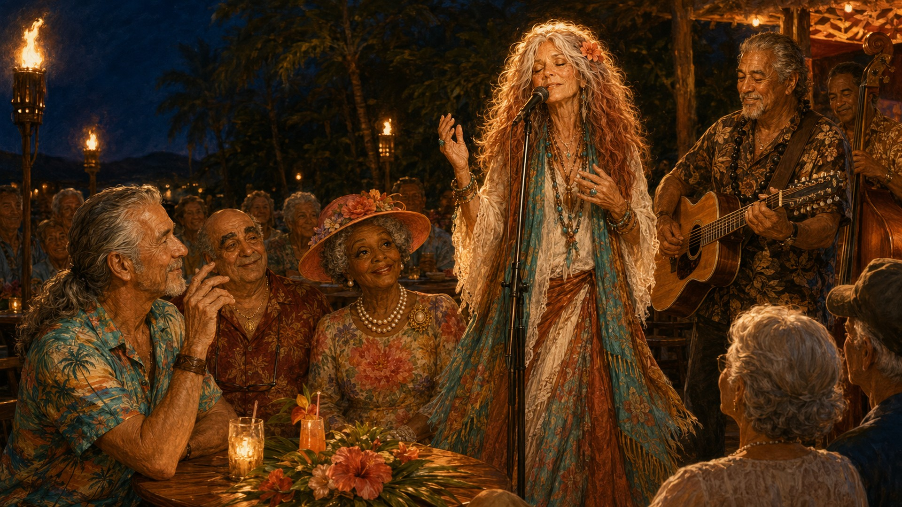

### 13. Dynamic Group Framing & Contrast Direction (Sunset Gathering)
Advanced rim-lighting simulation on clothing textures and gray hair structures under heavy sunset conditions.
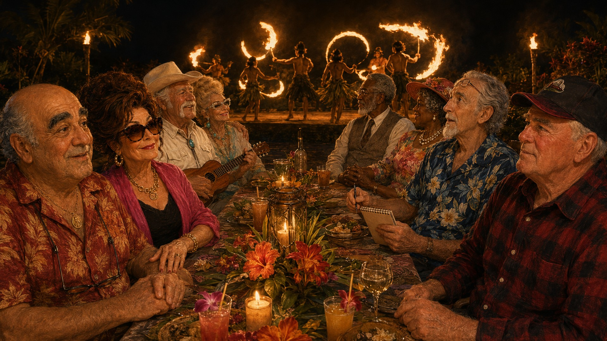

### 14. Situational Character Expressions (Local Luau Preparation)
Enforcing consistent emotional nuance and contextual clothing swaps according to specific script comedy directives.
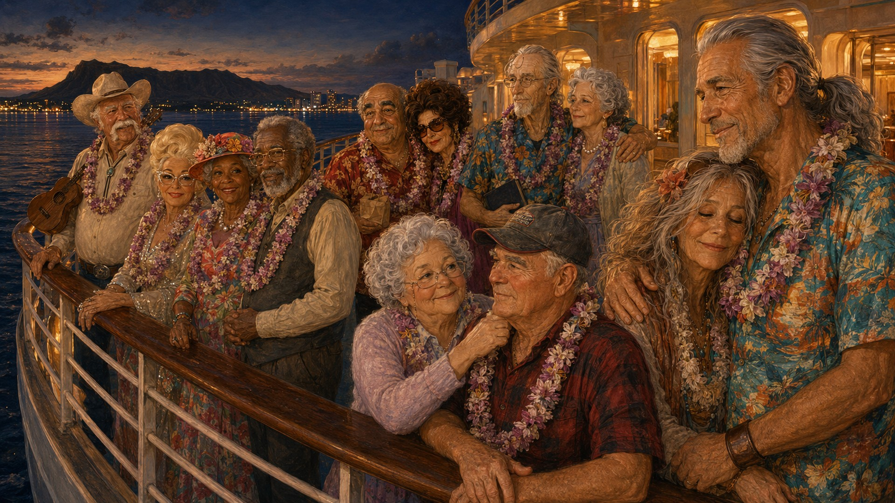

### 15. The Grand Narrative Closure (Midnight Farewell)
End-of-episode visual reward. Managing multi-tiered seating layouts and soft low-light volumetric shading to optimize viewer retention.
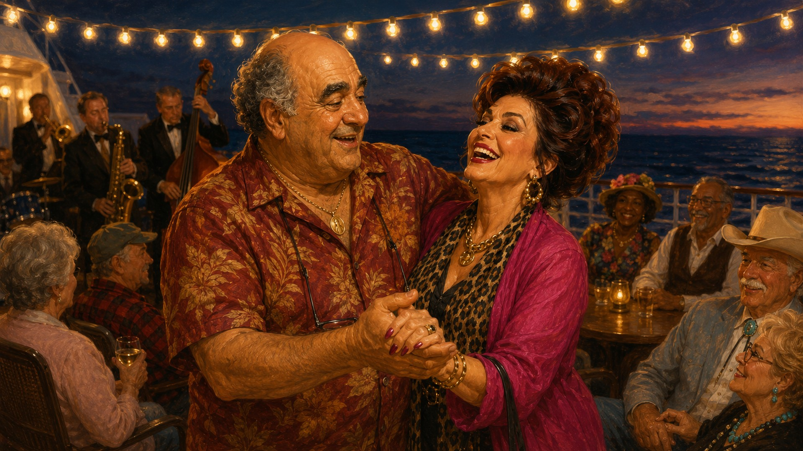

---

## 📈 Business Value & ROI

- **Production Velocity:** Increased content output velocity by **10x**, transforming a multi-person animation studio workflow into a sustainable single-operator pipeline.
- **Cost Efficiency:** **90% reduction** in manual prompt-and-error routines, shifting the designer's focus to pure high-level art direction, upscaling, and marketing psychology.
- **Scalability:** The custom pipeline core is modular. Any text-to-image or text-to-video API model can be plugged into the Python/Claude script infrastructure within hours.

---
*Commercial Notice: The core Python automation script, API token balancing algorithms, and specific prompt weights are proprietary commercial assets. The system architecture can be fully deployed, customized, and adapted to corporate brand books upon signing the official Job Offer and NDA.*
