# Walter Whitfield — Character Consistency & Visual Storytelling Breakdown

**Project:** Fun Cruise Stories · **Episode:** 26, *The Ghost in the Gadget* · **Story setting:** 2012

A visual case study showing how one recurring character is depicted across different compositions, lighting conditions, expressions, and ensemble scenes. This portfolio presents a character reference and twelve finished episode illustrations. It does **not** claim to document the original generation history or unprovided intermediate iterations.

## 1. Character reference

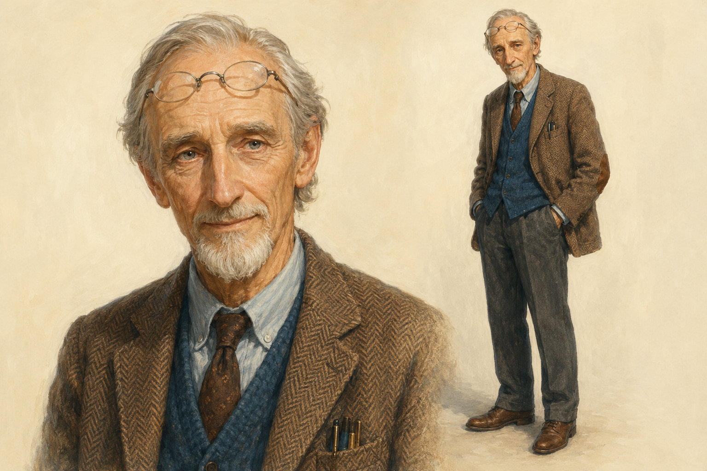

**Reference features to preserve:** swept-back silver-gray hair, slender face, neatly shaped gray beard and mustache, small round spectacles, brown patterned jacket, blue waistcoat, shirt and tie. The reference includes a portrait and full-body view.

## 2. Visual continuity goals

- **Identity:** keep Walter recognizable across close-ups, medium shots, group scenes and different camera angles.
- **Costume:** retain signature clothing and accessories where the scene calls for them.
- **Style:** maintain a coherent painterly, oil-and-gouache-inspired look.
- **Narrative:** adapt facial expression, gesture, staging and lighting to the story without losing character recognition.
- **Review:** inspect faces, glasses, hands, props and multi-person staging for visual drift and artifacts.

## 3. Finished scene gallery

The images below are **final scene examples**, not successive drafts of a single image. Some scenes feature supporting characters without Walter and are included to show episode-wide visual direction.

### Scene 01 — Ensemble introduction

Walter presents a notebook on the open deck in a large group. The character is recognizable through his silver hair, facial hair, glasses, tweed jacket and blue waistcoat.

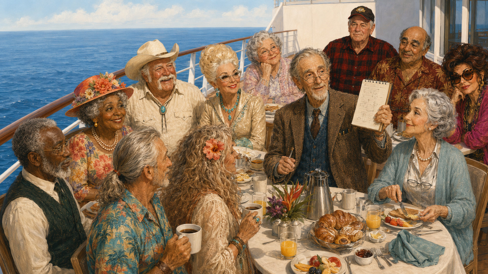

### Scene 02 — Supporting-character scene

A corridor interaction between two other cast members. This scene provides context for the broader episode, rather than evidence of Walter’s identity consistency.

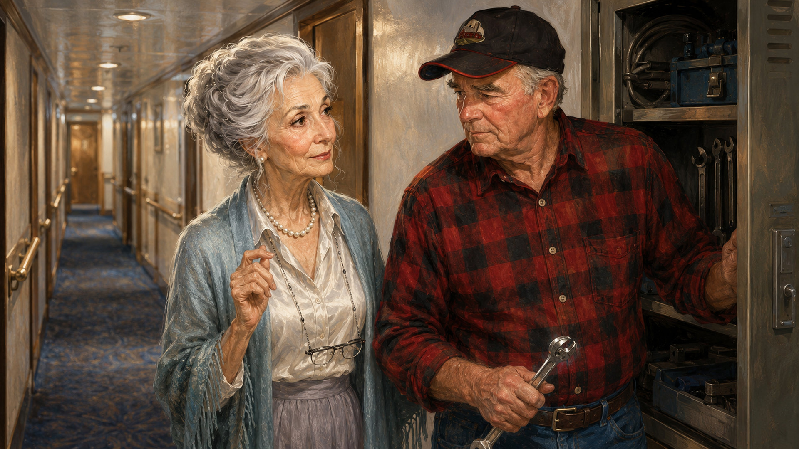

### Scene 03 — Supporting-character action

A close interaction around a mechanical device. Walter is not depicted; the frame demonstrates prop-oriented visual storytelling.

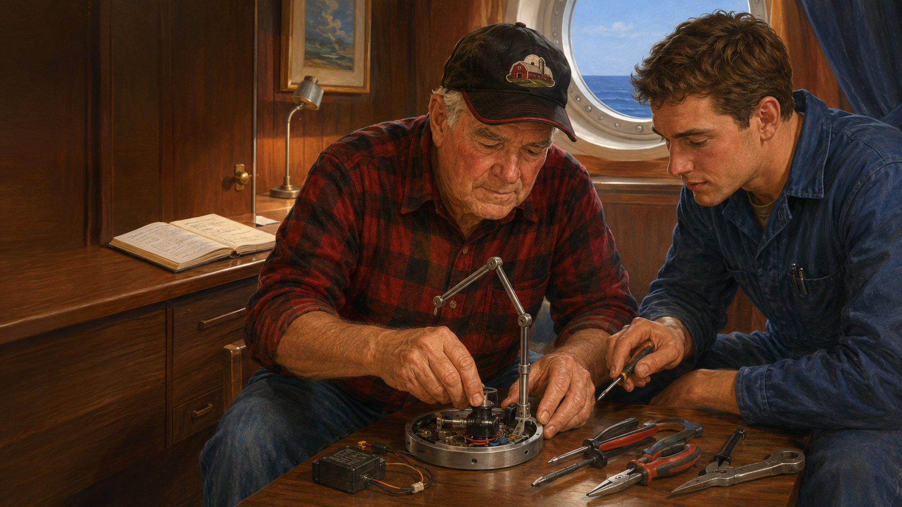

### Scene 04 — Quiet interior

Walter reads in a warmly lit cabin. The scene tests facial identity and wardrobe continuity in a medium shot.

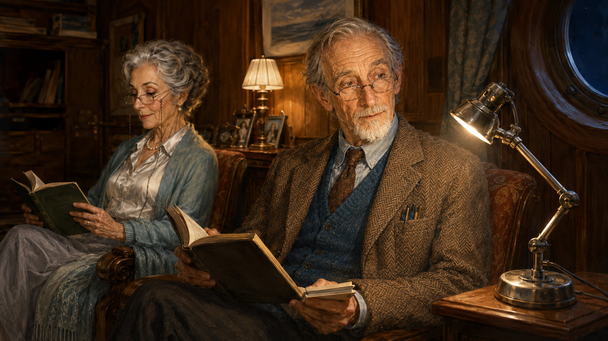

### Scene 05 — Outdoor ensemble

Walter appears seated with a notebook during a daytime deck activity, providing a smaller-scale group view.

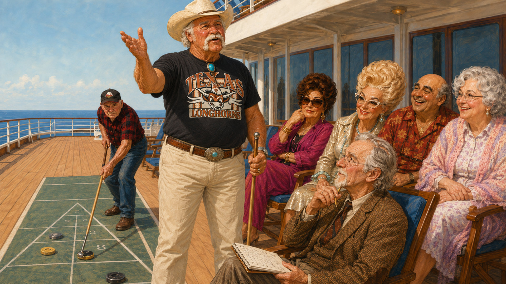

### Scene 06 — Nighttime dialogue

Walter listens to another character in a dark lounge setting, showing lighting adaptation and interaction.

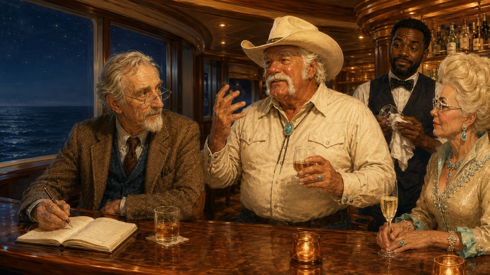

### Scene 07 — Focused work

Walter works at a desk with a lamp and notebook, using a low-light close-to-medium composition.

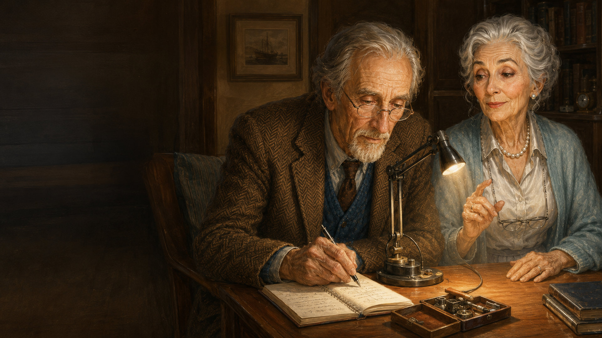

### Scene 08 — Group reveal

Walter stands near a lamp while the ensemble reacts. This tests his identity in an expressive multi-character frame.

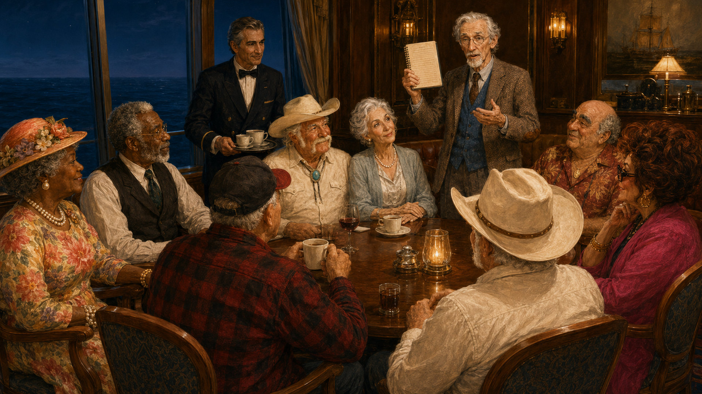

### Scene 09 — Hands-on interaction

Walter works with a small device alongside another character. This is a useful prop and gesture inspection frame.

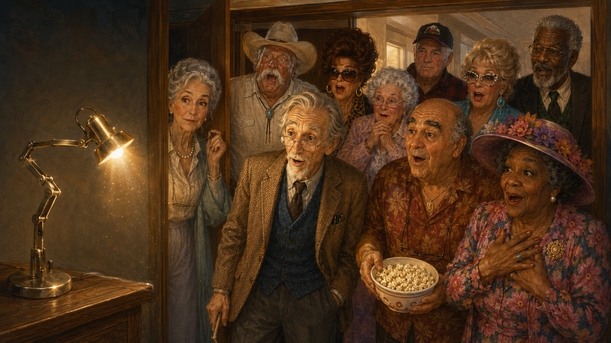

### Scene 10 — Collaborative troubleshooting

Walter and a companion examine the device while other characters watch. The scene emphasizes group staging.

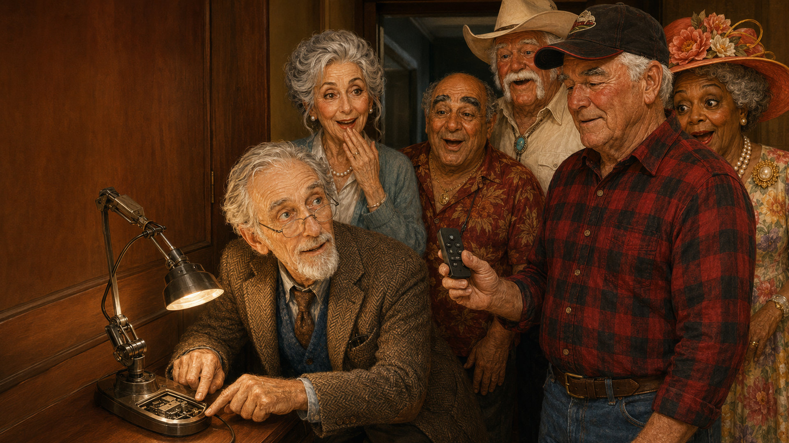

### Scene 11 — Ensemble resolution

Walter reacts beside the device as the surrounding characters respond. The scene tests facial expression in a crowded composition.

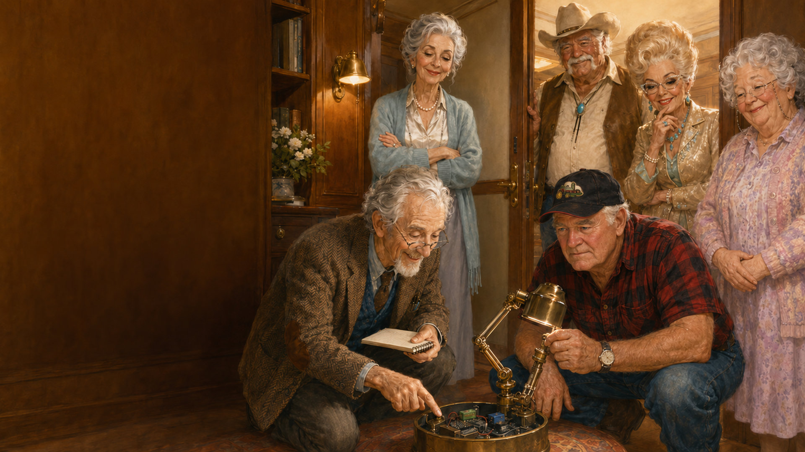

### Scene 12 — Night-deck closing scene

Walter and his companion stand at the rail under starlight. The scene offers a calmer profile and mixed-light continuity check.

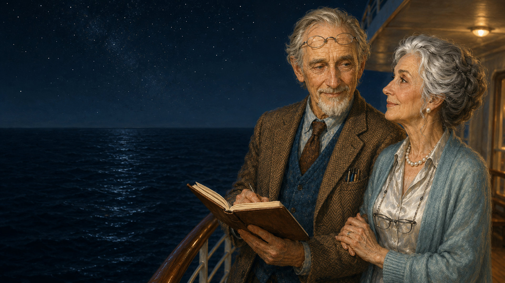

## 4. What the examples demonstrate

| Production challenge | Evidence in the gallery |
| --- | --- |
| Identity across composition | Character reference vs. scenes 01, 04, 05, 07, 08, 12 |
| Lighting changes | Bright deck scenes 01/05 vs. darker interiors 04/07/08 and night deck 12 |
| Ensemble staging | Scenes 01, 05, 08, 10, 11 |
| Object and hand interactions | Scenes 03, 07, 09, 10, 11 |
| Episode-wide style | All twelve finished scenes |

## 5. Review notes — strengths and limitations

The character remains broadly recognizable through repeated visual anchors such as his silver hair, glasses, facial hair and layered brown-and-blue wardrobe. However, the illustrations should not be described as **100% identical**: facial proportions, eyewear placement and fine costume details may vary between generations. Group scenes also warrant careful inspection of hands and object interactions. These are quality-control considerations, not evidence of a quantified success rate.

## 6. Creative workflow — overview

The following describes a **portfolio-level review framework**, not a verified step-by-step generation log for these exact images:

1. Define the character reference and persistent identity attributes.
2. Specify each scene’s narrative purpose, cast, location, shot type and lighting.
3. Generate candidate illustrations with reference-guided prompts.
4. Review identity, visual style, composition, anatomy, props and scene continuity.
5. Revise or regenerate where necessary, then select approved final frames.

### Making-of evidence still to add

For a genuine production-history breakdown, include dated original prompts, screenshots or saved intermediate generations, revision notes, tool/model versions, and the final selection decision. **These items have not been provided for this case study**, so no specific iteration counts, generation methods, time savings, or automation outcomes are asserted here.

## 7. My role / contribution

**Portfolio focus:** character reference direction, visual storytelling, scene briefs, prompt design, continuity review and selection of final illustrations. Exact tool usage and the division between manual and automated steps should be documented separately before being presented as production facts.

## 8. Project links

- [Fun Cruise Stories on YouTube](https://www.youtube.com/@FunCruiseStories)
- [AI Design Automation Showcase — GitHub](https://github.com/vsukhovoi/ai-design-automation-showcase)

---

**Portfolio note:** This case study demonstrates the consistency and visual direction of the supplied finished artwork. It is not a VFX compositing reel or proof of hands-on use of Midjourney, Kling, Seedance, Higgsfield or After Effects.
